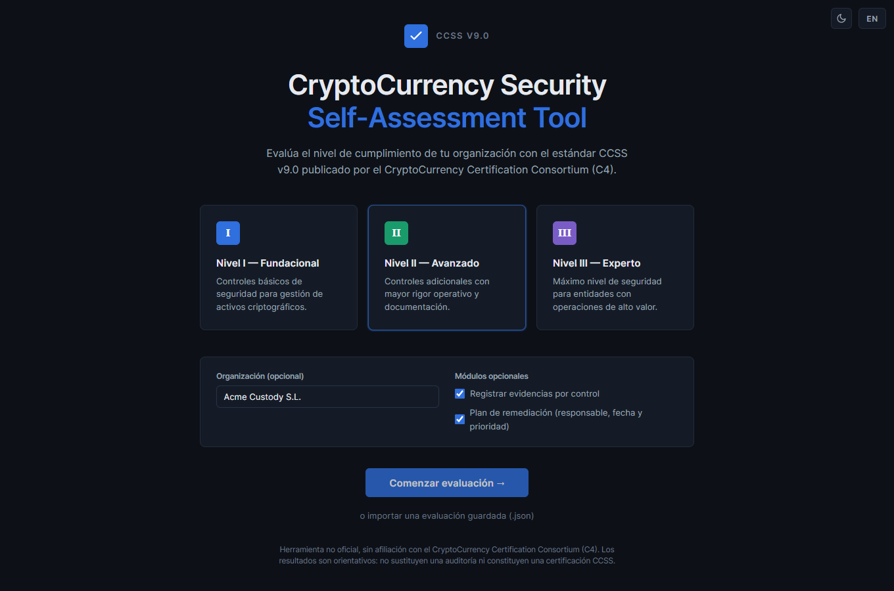
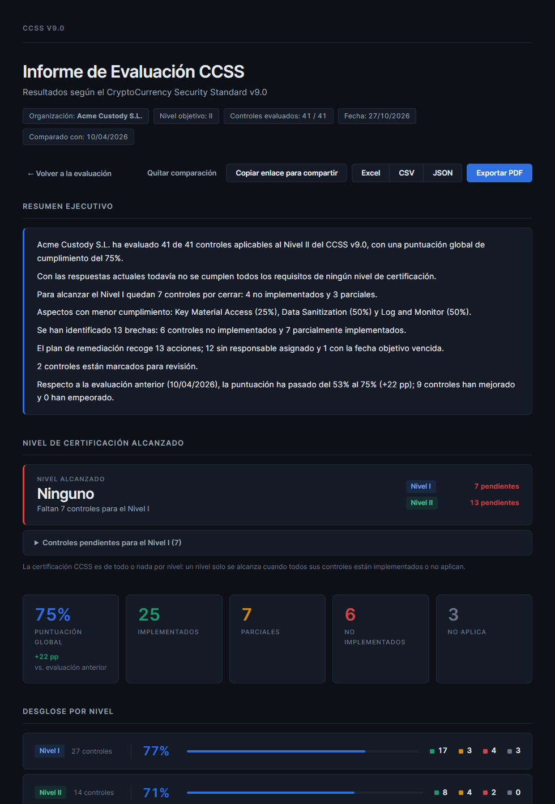
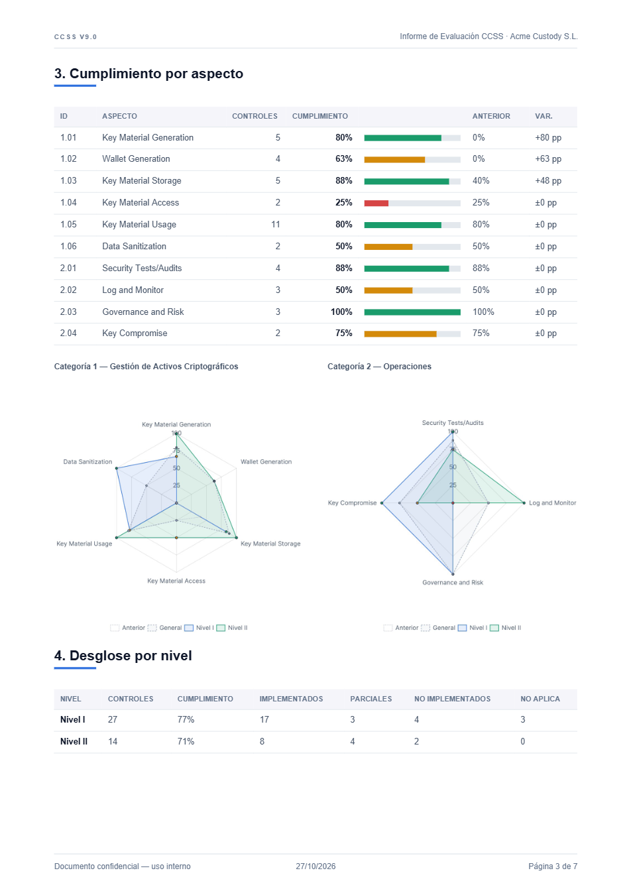

# CCSS v9 Self-Assessment Tool

> Herramienta de autoevaluación del CryptoCurrency Security Standard (CCSS) v9.0  
> Self-assessment tool for the CryptoCurrency Security Standard (CCSS) v9.0

[](LICENSE)

> [!IMPORTANT]
> **Herramienta no oficial**, sin afiliación con el CryptoCurrency Certification Consortium (C4). Los resultados son orientativos: no sustituyen una auditoría ni constituyen una certificación CCSS.  
> **Unofficial tool**, not affiliated with the CryptoCurrency Certification Consortium (C4). Results are indicative only: they do not replace an audit and do not constitute a CCSS certification.

<p align="center">
  
  
</p>

---

## Español

### ¿Qué es esto?

Una aplicación web estática que guía a una organización a través de una autoevaluación de cumplimiento del estándar **CCSS v9.0**, publicado por el [CryptoCurrency Certification Consortium (C4)](https://cryptoconsortium.org/). No necesita servidor, instalación ni conexión a internet.

### Características

- **51 controles** en 10 aspectos y 2 categorías: 27 de Nivel I, 14 de Nivel II y 10 de Nivel III.
- **3 niveles de certificación**: Nivel I (Fundacional), Nivel II (Avanzado), Nivel III (Experto).
- Preguntas y guía de evaluación en **español e inglés**, cambiables en tiempo real.
- 4 estados por control: Implementado / Parcialmente implementado / No implementado / No aplica.
- **Nivel alcanzado**: la certificación CCSS es de todo o nada por nivel; el informe indica qué nivel se cumple y qué controles faltan para el siguiente.
- **Resumen ejecutivo** generado automáticamente.
- **Informe visual** con gráficos de radar, puntuación global, desglose por nivel, brechas y tabla detallada.
- Módulos opcionales: **evidencias por control** y **plan de remediación** (responsable, fecha objetivo y prioridad).
- **Marcar controles para revisar** y filtrar la barra lateral por sin responder, marcados o brechas.
- **Atajos de teclado**: `1`–`4` responder, `←`/`→` navegar, `M` marcar, `R` ver requisito.
- **Informe PDF** paginado con texto real: portada, resumen, nivel alcanzado, cumplimiento por aspecto, brechas, plan de remediación y anexo.
- **Exportar a Excel y CSV**, y **guardar/importar en JSON** para retomar la evaluación.
- **Comparar con una evaluación anterior** (JSON): evolución de la puntuación, por aspecto y por control.
- **Compartir resultados** mediante un enlace (ver [Privacidad y seguridad](#privacidad-y-seguridad)).
- Temas claro y oscuro.

<p align="center"></p>

### Uso

1. Abrir `index.html` en cualquier navegador moderno, o usar la versión publicada en GitHub Pages.
2. Seleccionar el nivel objetivo (I, II o III) y, opcionalmente, el nombre de la organización y los módulos.
3. Responder las preguntas de cada control.
4. Consultar el informe y exportarlo.

### Privacidad y seguridad

- **Ningún dato sale del navegador.** La evaluación se guarda en el `localStorage` del navegador y todas las librerías y fuentes se sirven desde el propio proyecto (`vendor/`), sin CDNs, analítica ni peticiones a terceros.
- **Los enlaces para compartir contienen la evaluación completa** codificada en Base64 en el fragmento de la URL (`#share=...`): brechas, notas, evidencias y responsables. El fragmento no se envía al servidor, pero el enlace queda en chats, correos e historiales del navegador. Trátalo como información confidencial y compártelo solo por canales de confianza. Para entregar resultados de forma controlada, usa el PDF o el JSON.
- Para reportar vulnerabilidades, consulta [SECURITY.md](SECURITY.md).

### Personalización

Edita [js/config.js](js/config.js) para cambiar el nombre mostrado, el logotipo y los colores corporativos.

### Publicar en GitHub Pages

En el repositorio: **Settings → Pages → Build and deployment → Deploy from a branch**, rama `main`, carpeta `/ (root)`. Al ser una web estática no necesita ningún paso de compilación.

### Estructura del proyecto

```
ccss-assessment/
├── index.html          # Carcasa HTML + layout de las 3 pantallas
├── favicon.svg         # Icono de la aplicación
├── ccss-v9.json        # Datos de referencia del estándar CCSS v9.0
├── css/
│   └── styles.css      # Estilos (temas claro y oscuro)
├── js/
│   ├── config.js       # Marca: nombre, logotipo y colores
│   ├── data.js         # ASPECTS y CONTROLS con preguntas bilingües
│   ├── state.js        # Estado global, persistencia y helpers
│   ├── i18n.js         # Cadenas de texto ES/EN + función t()
│   ├── analysis.js     # Puntuaciones, nivel alcanzado, brechas, comparación y resumen
│   ├── export.js       # Exportar/importar JSON, CSV y Excel
│   ├── welcome.js      # Pantalla de bienvenida y selector de nivel
│   ├── assessment.js   # Barra lateral, tarjeta de pregunta, navegación y atajos
│   ├── report.js       # Informe, gráficos, comparación y compartir
│   └── pdf.js          # Informe PDF paginado
├── vendor/             # Librerías y fuente de terceros (ver vendor/README.md)
└── docs/               # Capturas para este README
```

---

## English

### What is this?

A static web application that guides an organization through a compliance self-assessment against the **CCSS v9.0** standard, published by the [CryptoCurrency Certification Consortium (C4)](https://cryptoconsortium.org/). No server, installation or internet connection required.

### Features

- **51 controls** across 10 aspects and 2 categories: 27 at Level I, 14 at Level II and 10 at Level III.
- **3 certification levels**: Level I (Foundational), Level II (Advanced), Level III (Expert).
- Questions and assessment guidance in **Spanish and English**, switchable at runtime.
- 4 statuses per control: In Place / Partially In Place / Not In Place / Not Applicable.
- **Level achieved**: CCSS certification is all-or-nothing per level; the report shows which level is met and which controls are missing for the next one.
- Auto-generated **executive summary**.
- **Visual report** with radar charts, overall score, level breakdown, gaps and a detailed table.
- Optional modules: **evidence per control** and **remediation plan** (owner, due date and priority).
- **Flag controls for review** and filter the sidebar by unanswered, flagged or gaps.
- **Keyboard shortcuts**: `1`–`4` answer, `←`/`→` navigate, `M` flag, `R` show requirement.
- **Paginated, text-based PDF report**: cover, summary, level achieved, compliance by aspect, gaps, remediation plan and annex.
- **Excel and CSV export**, plus **JSON save/import** to resume an assessment.
- **Compare with a previous assessment** (JSON): score, per-aspect and per-control progress.
- **Share results** via a link (see [Privacy and security](#privacy-and-security)).
- Light and dark themes.

### Usage

1. Open `index.html` in any modern browser, or use the GitHub Pages deployment.
2. Select the target level (I, II or III) and, optionally, the organization name and modules.
3. Answer the questions for each control.
4. Review and export the report.

### Privacy and security

- **No data leaves the browser.** The assessment is stored in the browser's `localStorage`, and all libraries and fonts are served from the project itself (`vendor/`): no CDNs, analytics or third-party requests.
- **Share links contain the full assessment** Base64-encoded in the URL fragment (`#share=...`): gaps, notes, evidence and owners. The fragment is never sent to a server, but the link ends up in chats, emails and browser histories. Treat it as confidential and only share it through trusted channels. Use the PDF or JSON export for controlled delivery.
- To report a vulnerability, see [SECURITY.md](SECURITY.md).

### Customization

Edit [js/config.js](js/config.js) to change the displayed name, logo and brand colors.

### Deploying to GitHub Pages

In the repository: **Settings → Pages → Build and deployment → Deploy from a branch**, branch `main`, folder `/ (root)`. It is a static site, so no build step is needed.

---

## Standard attribution / Atribución del estándar

The CryptoCurrency Security Standard (CCSS) is developed and maintained by the [CryptoCurrency Certification Consortium (C4)](https://cryptoconsortium.org/). The official requirement texts reproduced in `js/data.js` and `ccss-v9.json` belong to C4 and are included for reference only; they are **not** covered by this project's MIT license. The official standard is available at [cryptoconsortium.org/ccss-table-v9](https://cryptoconsortium.org/ccss-table-v9/).

El CCSS es desarrollado y mantenido por el C4. Los textos oficiales de los requisitos incluidos en `js/data.js` y `ccss-v9.json` pertenecen a C4 y se reproducen solo como referencia; **no** están cubiertos por la licencia MIT de este proyecto.

Other references: NIST SP 800-88 (media sanitization), NIST SP 800-90A (DRBG), ISO/IEC 27005 and NIST SP 800-37 (risk management).

## Contributing / Contribuir

See [CONTRIBUTING.md](CONTRIBUTING.md).

## License / Licencia

Source code: MIT © 2025 Daniel Díaz Lajara — see [LICENSE](LICENSE).  
Third-party libraries and fonts in `vendor/` keep their own licenses — see [vendor/README.md](vendor/README.md).
